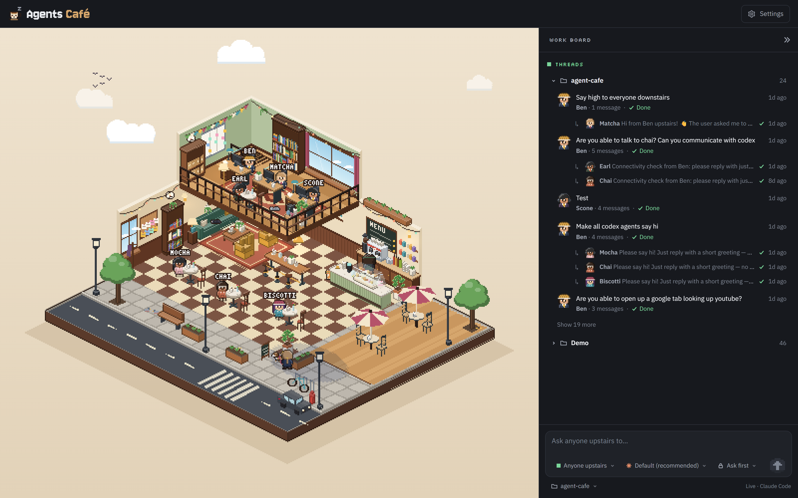
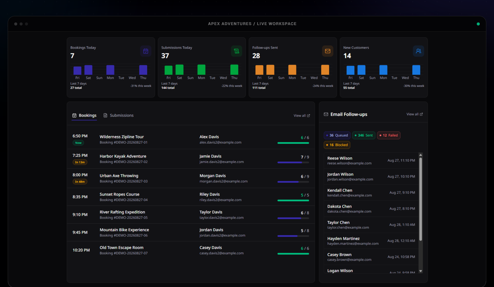
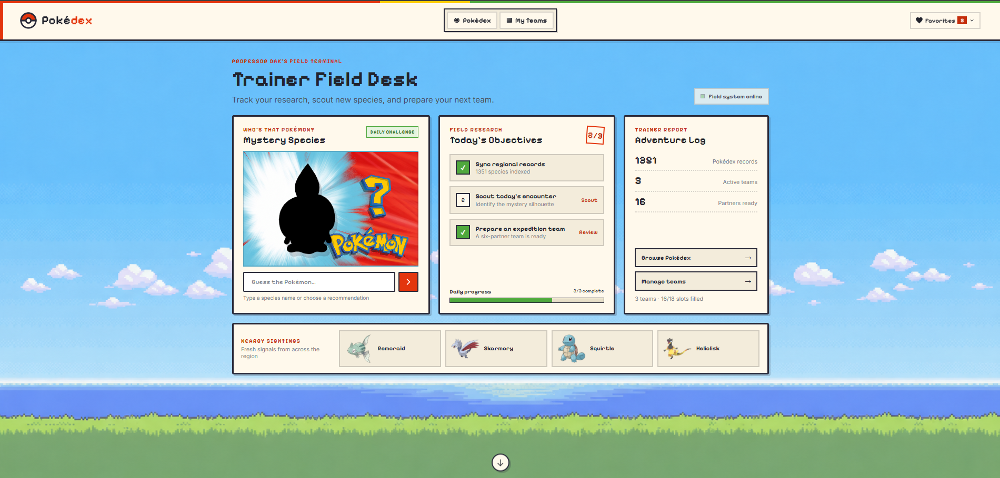

# Jesus Velazquez

**Full-stack software engineer.** I turn complicated workflows into software people can trust.

By day I'm a technical lead on a team building secure, data-heavy web applications with React, TypeScript, Java, and Kubernetes. On my own time I co-founded Waiver Director, a digital waiver platform for experience operators, and I build Agents Café, a place to run coding agents side by side. Most of my side-project hours now go to AI developer tools: agents, MCP, and tool calling.

[Portfolio](https://jesusvelazquez.dev) · [LinkedIn](https://linkedin.com/in/jesusvelazquez980) · [Email](mailto:jesusvelazquez0980@gmail.com)

## Agents Café

A local control room for Claude Code and Codex agents, drawn as a two-story pixel-art café. A tool call walks the agent to that tool's station, so you can see what everyone is doing at a glance. Agents can message each other and delegate work across both harnesses, and it all runs on your own subscriptions, with no API keys.

**[Try the demo](https://agentscafe.dev/demo)** · [Website](https://agentscafe.dev) · [Source](https://github.com/JesusVelaz/agent-cafe) · [Download](https://github.com/JesusVelaz/agent-cafe/releases/latest)

Next.js · TypeScript · Fastify · Prisma · SQLite · Claude Agent SDK

## More projects

<table>
  <tr>
    <td width="50%" valign="top">
      
      <h3>Waiver Director</h3>
      
Digital waivers that capture every participant, not only the person who booked. A multi-tenant SaaS with a waiver builder, booking integrations, and automated follow-up emails.

      
<a href="https://www.waiverdirector.com/">Visit the site</a>

      
SvelteKit · TypeScript · Convex · Resend

    </td>
    <td width="50%" valign="top">
      
      <h3>PokeDex App</h3>
      
A Pokédex with a daily silhouette guess, search and type filters across every species, and a team builder that saves your rosters in the browser.

      
<a href="https://jesusvelaz.github.io/PokeDex-App/">Open the app</a> · <a href="https://github.com/JesusVelaz/PokeDex-App">Source</a>

      
React · JavaScript · PokéAPI

    </td>
  </tr>
</table>

## Toolbox

| | |
|---|---|
| **AI & LLM** | Claude Agent SDK, MCP, tool calling, LLM evaluation, Vercel AI SDK |
| **Languages** | TypeScript, JavaScript, Python, Java, SQL, C |
| **Frontend** | React, Next.js, SvelteKit, component libraries, Section 508 accessibility |
| **Backend & data** | FastAPI, Fastify, REST APIs, Convex, Prisma, PostgreSQL, MySQL, Redis, SQLite |
| **Cloud & DevOps** | Kubernetes, Helm, Argo CD, Docker, GitLab CI/CD, AWS |

## Background

- B.A. in Computer Science from Florida International University (2023)
- Agentic AI certificate from MIT Lincoln Laboratory (2026)
- Fluent in English and Spanish

## Get in touch

I like hearing how other people run more than one coding agent at once. If you have Claude Code and Codex working together, or a setup that fell apart, tell me about it at [jesusvelazquez0980@gmail.com](mailto:jesusvelazquez0980@gmail.com) or in the [Agents Café issues](https://github.com/JesusVelaz/agent-cafe/issues).
